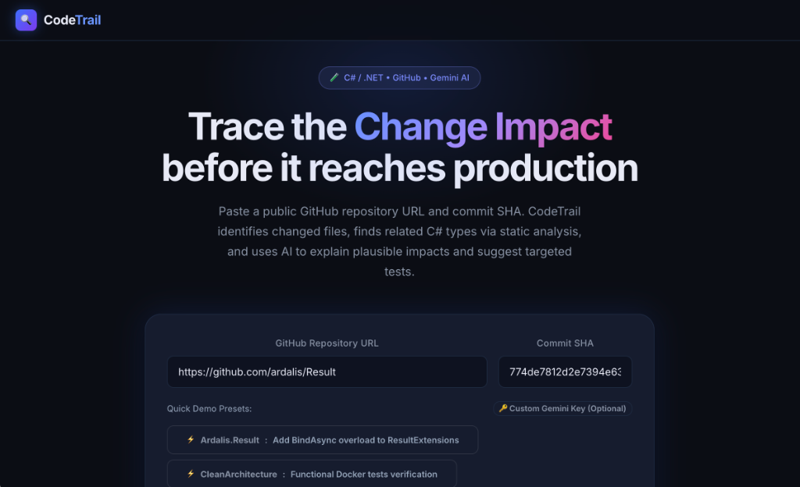
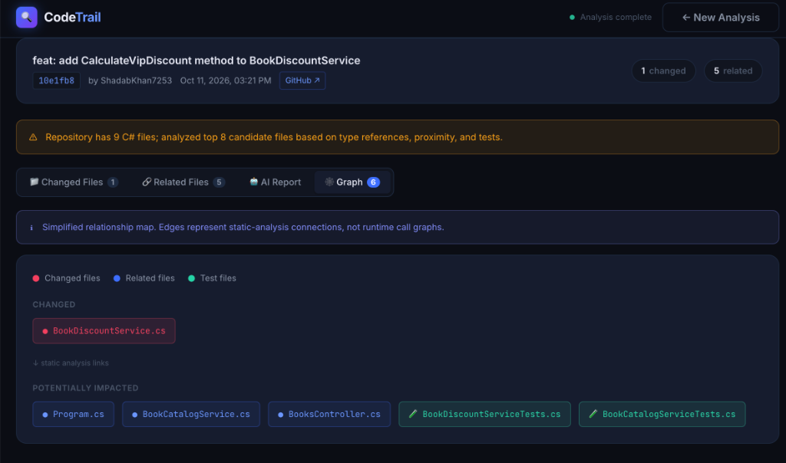
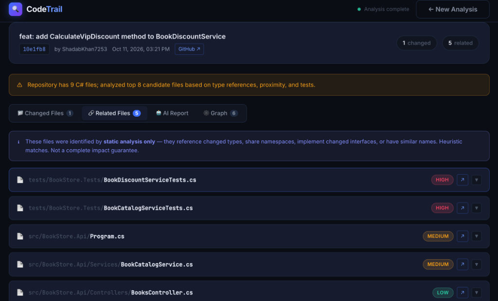
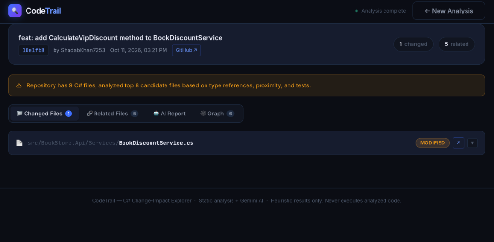

# CodeTrail 🔍

> **AI-Assisted Visual Change-Impact Explorer for C#/.NET Repositories**

[](https://dotnet.microsoft.com/)
[](https://angular.dev/)
[](https://aistudio.google.com/)
[](LICENSE)

CodeTrail helps developers, tech leads, and reviewers instantly understand the **blast radius** of any commit in a C# repository. Given a public GitHub repository URL and commit SHA, CodeTrail extracts modified symbols, traces dependent and affected source files using static C# analysis, renders an interactive dependency graph, and leverages Google Gemini AI to formulate impact hypotheses and suggest targeted tests.

---

## 📸 Preview

### 🏠 Home Screen & Analysis Portal


### 🕸️ Visual Change-Impact Graph


---

## 📑 Table of Contents
- [✨ Key Features](#-key-features)
- [📦 Companion Demo Project](#-companion-demo-project)
- [🖼️ Interface Screenshots](#️-interface-screenshots)
- [🏗 Architecture & Tech Stack](#-architecture--tech-stack)
- [⚙️ Prerequisites](#-prerequisites)
- [🚀 Quick Start Guide](#-quick-start-guide)
  - [1. Clone Repository](#1-clone-repository)
  - [2. Configure API Keys](#2-configure-api-keys)
  - [3. Start Backend (.NET Web API)](#3-start-backend-net-web-api)
  - [4. Start Frontend (Angular SPA)](#4-start-frontend-angular-spa)
- [🧪 How to Test and Verify](#-how-to-test-and-verify)
- [🔍 Static Analysis & AI Pipeline](#-static-analysis--ai-pipeline)
- [📡 API Reference](#-api-reference)
- [🔒 Security & Privacy](#-security--privacy)
- [❓ Troubleshooting & FAQs](#-troubleshooting--faqs)

---

## ✨ Key Features

- **Zero-Clone Inspection**: Analyze any public GitHub repository directly through the GitHub API without cloning gigabytes of code or running untrusted scripts.
- **Static C# Relationship Tracing**: Automatically extracts namespaces, types, interfaces, and methods from git diffs, cross-referencing imports (`using`), inheritance, and word-boundary references.
- **Confidence Scoring & Categorization**: Ranks potentially impacted files as **High**, **Medium**, or **Low** priority with inspectable evidence markers.
- **Interactive Visual Graph**: Color-coded dependency visualization:
  - 🔴 **Red**: Directly changed source files
  - 🔵 **Blue**: Potentially impacted dependent files
  - 🟢 **Green**: Associated unit & integration test files
- **Gemini 3.8 Flash AI Synthesis**: Delivers concise business logic impact summaries, edge-case risk assessments, and targeted unit test recommendations.

---

## 📦 Companion Demo Project

To allow anyone to test CodeTrail immediately with realistic C# business logic, we created and published an open companion repository:

👉 **[ShadabKhan7253 / CodeTrailSampleApp](https://github.com/ShadabKhan7253/CodeTrailSampleApp)**

| Property | Value |
|---|---|
| **Repository URL** | `https://github.com/ShadabKhan7253/CodeTrailSampleApp` |
| **Verified Test Commit** | `10e1fb8` |
| **Commit Message** | `feat: add CalculateVipDiscount method to BookDiscountService` |
| **Description** | Modifies discount calculation rules in a multi-project e-commerce architecture, triggering ripple effects across orders, controllers, and unit test suites. |

Anyone can copy-paste this URL and Commit SHA directly into CodeTrail's home screen to see the full analysis pipeline in action!

---

## 🖼️ Interface Screenshots

<div align="center">

### Static Analysis & Priority Ranking
*Categorizes affected classes and test files with concrete evidence.*


### Changed Files & Unified Git Diff
*Displays exact syntax changes and extracted symbols.*


</div>

---

## 🏗 Architecture & Tech Stack

```
CodeTrail/
├── frontend/               # Angular 22 Single Page Application (http://localhost:4200)
│   ├── src/app/
│   │   ├── components/     # Analysis form, File diff, Graph viewer, AI Report card
│   │   ├── services/       # AnalysisService (HTTP client to backend)
│   │   └── models/         # TypeScript analysis contracts
├── backend/                # ASP.NET Core 10 Web API (http://localhost:5050)
│   ├── Controllers/        # AnalysisController (POST /api/analysis, GET /api/health)
│   ├── Services/
│   │   ├── GitHubService.cs        # GitHub REST client with raw content fallback
│   │   ├── CSharpAnalyzer.cs       # Static symbol & reference extraction
│   │   ├── GeminiAiService.cs      # Google Gemini 3.8 Flash AI reasoning
│   │   └── AnalysisOrchestrator.cs # Parallelized pipeline coordinator
│   ├── Models/             # C# DTOs and analysis graph models
│   ├── appsettings.json    # Base configuration
│   └── appsettings.Local.json # Untracked local secrets file
└── docs/images/            # High-resolution screenshots and media
```

| Component | Technology | Default URL / Port |
|-----------|------------|---------------------|
| **Backend API** | ASP.NET Core 10, C# | `http://localhost:5050` |
| **Frontend UI** | Angular 22, TypeScript, Vanilla CSS | `http://localhost:4200` |
| **AI Engine** | Google Gemini `gemini-3.8-flash` | Google AI Studio REST API |
| **Code Source** | GitHub REST API + raw content endpoints | api.github.com |

---

## ⚙️ Prerequisites

Ensure you have the following installed:

| Tool | Minimum Version | Installation Link |
|------|-----------------|-------------------|
| **.NET SDK** | .NET 10.x | [Download .NET SDK](https://dotnet.microsoft.com/download) |
| **Node.js** | 18.x or 20.x+ | [Download Node.js](https://nodejs.org/) |
| **npm** | 9.x+ | Included with Node.js |
| **Git** | 2.x+ | [Download Git](https://git-scm.com/) |

---

## 🚀 Quick Start Guide

### 1. Clone Repository

```bash
git clone https://github.com/ShadabKhan7253/CodeTrail.git
cd CodeTrail
```

### 2. Configure API Keys

CodeTrail requires a **Google Gemini API Key** for AI impact analysis. A **GitHub Token** is optional, but recommended to increase the GitHub rate limit from 60 req/hr to 5,000 req/hr.

> [!TIP]
> Get a free API key at [Google AI Studio](https://aistudio.google.com/app/apikey).

#### Option A: Local Config File (Recommended)
Create `backend/appsettings.Local.json` (this file is git-ignored and never committed):

```json
{
  "GEMINI_API_KEY": "your_gemini_api_key_here",
  "GITHUB_TOKEN": "your_optional_github_token_here"
}
```

#### Option B: Environment Variables
Alternatively, export the variables in your terminal:

```bash
# macOS / Linux
export GEMINI_API_KEY="your_gemini_api_key_here"
export GITHUB_TOKEN="your_optional_github_token_here"

# Windows (Command Prompt)
set GEMINI_API_KEY=your_gemini_api_key_here
set GITHUB_TOKEN=your_optional_github_token_here

# Windows (PowerShell)
$env:GEMINI_API_KEY="your_gemini_api_key_here"
$env:GITHUB_TOKEN="your_optional_github_token_here"
```

### 3. Start Backend (.NET Web API)

The backend is configured to listen on **port 5050**:

```bash
cd backend
dotnet run
```

Verify backend health at `http://localhost:5050/api/health`:
```bash
curl http://localhost:5050/api/health
# {"status":"healthy","service":"CodeTrail.Api"}
```

### 4. Start Frontend (Angular SPA)

In a separate terminal window:

```bash
cd frontend
npm install
npm start
```

Navigate to:
👉 **`http://localhost:4200`**

---

## 🧪 How to Test and Verify

1. Open **`http://localhost:4200`** in your browser.
2. In the **GitHub Repository URL** input, enter:
   ```text
   https://github.com/ShadabKhan7253/CodeTrailSampleApp
   ```
3. In the **Commit SHA** input, enter:
   ```text
   10e1fb8
   ```
4. Click **Analyze Commit**.
5. **Expected Output**:
   - **Changed Files Tab**: Displays `src/BookStore.Api/Services/BookDiscountService.cs` with diff markers.
   - **Related Files Tab**: Identifies 5 affected files (`BookDiscountServiceTests.cs`, `BookCatalogServiceTests.cs`, `Program.cs`, `BookCatalogService.cs`, `BooksController.cs`) classified by High/Medium/Low confidence.
   - **Visual Graph Tab**: Renders the complete node graph showing relationships from the changed service to dependent controllers and unit tests.
   - **AI Report Tab**: Gemini 3.8 Flash summarizes the business rationale (VIP discount addition), potential edge cases, and targeted tests to run.

---

## 🔍 Static Analysis & AI Pipeline

```
GitHub Repository + Commit SHA
              │
              ▼
   1. Fetch Unified Git Diff & Changed Files
              │
              ▼
   2. Regex-Based C# Symbol Extraction (Classes, Interfaces, Namespaces)
              │
              ▼
   3. File Tree Exploration & Parallel Candidate Retrieval
              │
              ▼
   4. Heuristic Evidence Matching (Type refs, Usings, Inheritance, Test markers)
              │
              ▼
   5. Google Gemini 3.8 Flash Synthesis
              │
              ▼
   Visual Impact Graph + Detailed Report
```

- **Symbol Extraction**: Extracts `namespace`, `class`, `interface`, `record`, `struct`, and `enum` declarations without requiring heavy local compilation or MSBuild tooling.
- **Reference Scanning**: Searches candidate source files for explicit `using` statements, word-boundary type usages, and naming proximity.
- **Bounded Remote Fetching**: Safely downloads candidate files concurrently via GitHub's API and raw endpoints with timeout protection.

---

## 📡 API Reference

### Health Check
```http
GET /api/health
```
```json
{
  "status": "healthy",
  "service": "CodeTrail.Api"
}
```

### Analyze Commit
```http
POST /api/analysis
Content-Type: application/json
```
```json
{
  "repositoryUrl": "https://github.com/owner/repo",
  "commitSha": "commit-sha",
  "geminiApiKey": "optional-key-override",
  "gitHubToken": "optional-token-override"
}
```

---

## 🔒 Security & Privacy

- **No Remote Code Execution**: CodeTrail treats all repository code strictly as static text data. It never runs scripts, compiles assemblies, or invokes tests from the analyzed repository.
- **Secret Isolation**: Sensitive API credentials stored in `appsettings.Local.json` are excluded from Git tracking via `.gitignore`.
- **Domain Validation**: Restricts input repository URLs exclusively to `https://github.com/`.

---

## ❓ Troubleshooting & FAQs

### Q: Port 5050 or 5000 is already in use
**A:** On macOS, port 5000 is often reserved by AirPlay Receiver. CodeTrail uses **port 5050**. If port 5050 is busy:
```bash
lsof -i :5050
kill -9 <PID>
```

### Q: GitHub rate limit exceeded (HTTP 403)
**A:** Unauthenticated GitHub API calls are limited to 60 per hour. Add a free personal access token in `appsettings.Local.json` (`GITHUB_TOKEN`) to boost this limit to 5,000 requests/hour.

### Q: How do I stop the servers?
**A:** Press `Ctrl + C` in the respective terminal tabs where `dotnet run` or `npm start` are running.

---

## 📄 License

This project is licensed under the MIT License — see the [LICENSE](LICENSE) file for details.
